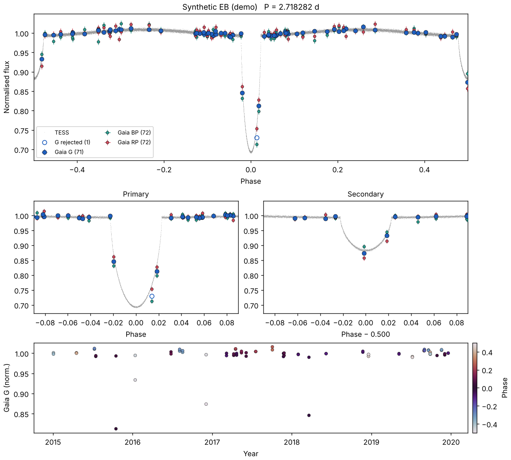
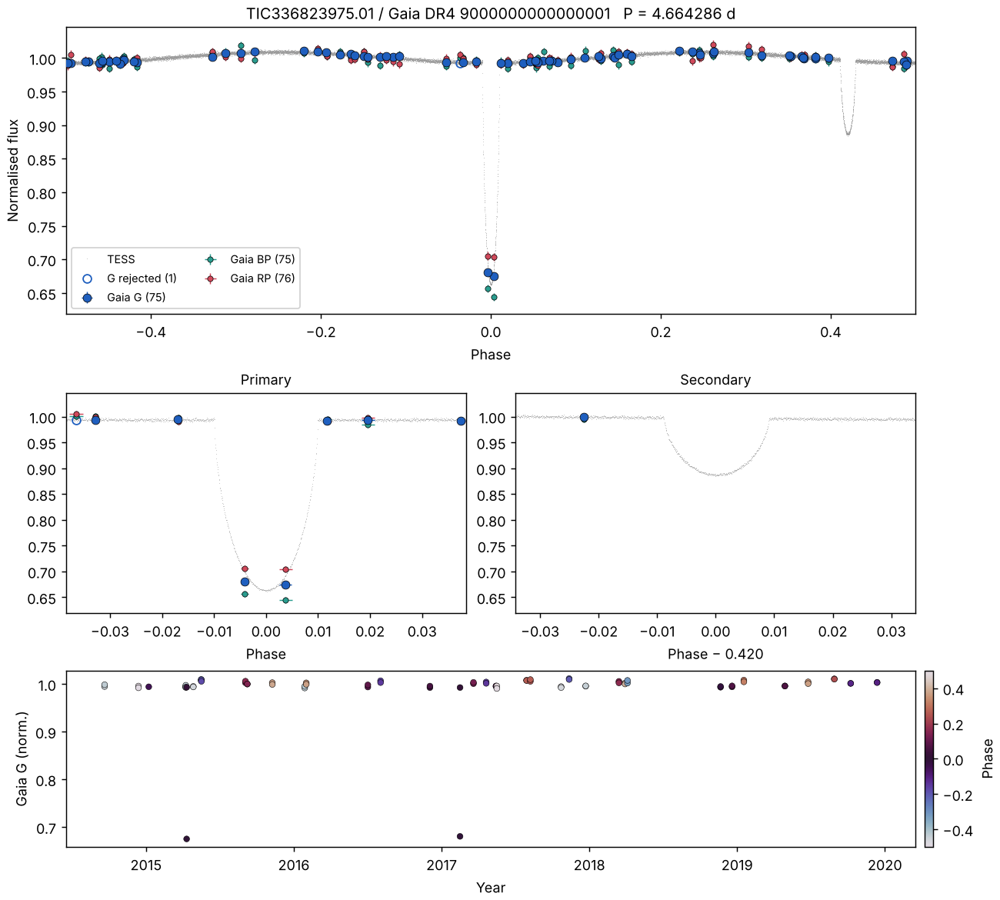
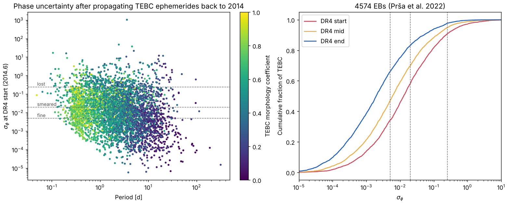

# Gaia × TESS Eclipsing Binary Atlas (`ebatlas`)

**Gaia's ~70 sparse epochs, phase-folded on precise TESS ephemerides.**


*Synthetic demo (no real data). Top: TESS light curve (grey) folded on its ephemeris, with Gaia G/BP/RP epochs overplotted; horizontal error bars show the propagated ephemeris uncertainty at each Gaia epoch. Middle: zooms on each eclipse; open circles mark points Gaia's pipeline rejected. Bottom: Gaia G epochs vs. time, coloured by phase.*

A project for the [2026 Gaia Relay](http://gaia.lol) (KITP leg). Contributions from any leg are welcome; see [CONTRIBUTING.md](CONTRIBUTING.md) and the [relay log](docs/RELAY_LOG.md).

## Why

Gaia DR3 published epoch photometry only for sources its pipeline classified as variable, about 11.7 million of them, including ~2.2 million eclipsing-binary candidates (Mowlavi et al. 2023). DR4 publishes epoch data for *all* sources. Folding those epochs on TESS ephemerides lets us:

1. **See Gaia catching eclipses Gaia never flagged.** With ~70 visits and a known period, even a handful of in-eclipse points is a detection. The interesting sample is TESS EBs that are *absent* from DR3 `vari_eclipsing_binary`.
2. **Identify the true host.** TESS pixels are 21″, so a TESS eclipse can come from a blended neighbour. Gaia resolves those neighbours, and with DR4 epoch photometry for all of them, we can check which one actually dips.
3. **Measure chromatic eclipse depths.** G, BP and RP depths constrain the temperature ratio independently of TESS.
4. **Cross-check orbits.** Compare DR4 non-single-star solutions (SB1/SB2, eclipsing, astrometric) against TESS periods, and use RUWE, acceleration solutions and epoch astrometry to test for tertiaries predicted by eclipse-timing variations.

## Status

> **DR4 status.** DR4 has not been released. The DR4 epoch-astrometry reader was developed against the draft data model and a pre-release sample, which is not distributed here; its tests skip when the sample is absent. The DR4 epoch-photometry reader follows the draft data model and has been rehearsed end to end on synthetic files in that format (`examples/release_day_rehearsal.py`). See [docs/DR4_NOTES.md](docs/DR4_NOTES.md).

| Component | Status |
|---|---|
| Time systems (Gaia TCB ↔ TESS BTJD), ephemeris propagation, in-eclipse flags | ✅ tested |
| Atlas page + per-target summary statistics | ✅ tested on synthetic data |
| TEBC reader (Prša et al. 2022 export), with quirks handled | ✅ tested on the real file |
| Eclipse width / depth / secondary-phase measurement from TESS | ✅ tested on synthetic data |
| Ephemeris-precision forecast at DR4 epochs | ✅ run on full TEBC |
| DR3 epoch photometry fetch (DataLink) | ⚠️ written, needs live testing |
| TIC → DR2 → DR3 cross-match; DR3 RUWE / NSS / EB-flag context; neighbour cone search | ⚠️ written, needs live testing |
| TESS light curves (lightkurve) | ⚠️ written, FFI-only targets need work |
| Catalog readers for TESS-10k, TESS M+Ms | ❌ templates only |
| DR4 epoch astrometry: reader, barycentric times, 5-param AL fit, astrometric periodogram, Keplerian grid fit | ✅ validated on pre-release sample |
| DR4 epoch photometry: reader, flags, cached/resumable DataLink fetch | ✅ tested on data-model-format synthetics |
| Staged cross-match: TIC→DR2→DR3 now; DR3→DR4 + `has_epoch_photometry` on release day | ⚠️ written; DR4 column names unconfirmed |
| NSS comparison, epoch-RV folding | ❌ planned |

## Release-day plan

1. **Now:** `python scripts/01_prepare_dr3_xmatch.py data/TEBC.csv data/tebc_dr3_xmatch.ecsv`. This caches DR3 IDs and DR3 context, including which TEBC systems already had DR3 epoch photometry.
2. **Release day:** confirm `DR4_XMATCH` and `DR4_DATALINK` against the published schema, then run `scripts/02_release_day.sh --limit 10`, then the full run. Fetches are cached per source and resume after interruptions.
3. **Rehearse anytime:** `python examples/release_day_rehearsal.py data/TEBC.csv` (offline).


*Rehearsal: a real TEBC ephemeris with synthetic DR4-format Gaia photometry and a synthetic TESS light curve. This system was given an eccentric orbit (secondary at phase 0.42) to test the eclipse-geometry measurement.*

## Quick start

```bash
git clone <this repo> && cd gaia-tess-eb-atlas
pip install -e ".[dev,online]"
pytest                                  # offline tests
python examples/synthetic_demo.py       # writes docs/synthetic_demo.png
```

With network access and a catalog in the unified schema:

```bash
ebatlas-build data/TEBC.csv --catalog tebc --out atlas/ --release dr3 --limit 25
```

This writes one PNG per target and `atlas/summary.csv` with Gaia epoch counts, in-eclipse counts (`secure` and `possible`, given ephemeris drift), in-eclipse points rejected by Gaia, depth S/N, RUWE, and whether DR3 already flagged the source as an EB.

## First result: TEBC ephemerides at Gaia epochs



TEBC ephemerides come from TESS sectors 1–26 (2018–2020). Gaia DR4 epochs start in mid-2014, so each ephemeris has to be projected back by up to thousands of cycles. Of the 4,574 TEBC EBs with a usable ephemeris, the median phase uncertainty at the start of DR4 is 0.013. Only 34% have σ_φ < 0.005 there, and 9% have effectively lost phase coherence (σ_φ > 0.25). By the end of DR4 these improve to 66% and 2%. Short-period, contact-like systems fare worst.

Two consequences follow. First, TEBC ephemerides should be refit using all TESS sectors to date, which extends the baseline from ~2 to ~8 years and shrinks period errors substantially. Second, the reverse is also a science product. For well-folded systems, Gaia's 2014–2019 in-eclipse epochs extend the timing baseline to ~12 years, which bears directly on period changes and tertiary companions.

Reproduce with `python examples/tebc_ephemeris_precision.py data/TEBC.csv` (no network needed).

## Things that bite

- **Time systems.** Gaia epochs are BJD(TCB) − 2455197.5; TESS is BJD(TDB) − 2457000. TCB − TDB is ~19 s during the mission. Harmless for folding, fatal for timing.
- **Ephemeris drift.** Propagating a TESS ephemeris back to 2014 can span thousands of cycles. `Ephemeris.phase_sigma` and `is_reliable_at` flag targets whose fold is not trustworthy at Gaia epochs.
- **Outlier rejection.** In DR4, outlier rejection affects only the mean photometry; epoch fluxes keep in-eclipse points. We count in-eclipse transits Gaia flagged as outliers, and plot (not drop) transits with no usable flux. The variability pipeline's epoch flags are a separate product.
- **Few points per eclipse.** With ~70 transits and an eclipse lasting 1–2% of the orbit, expect only ~1 point per eclipse for many detached systems. Wide eclipses and short periods fare best.
- **Cross-match ambiguity.** DR2 sources can split into several DR3 sources; `dr2_to_dr3` keeps all candidates and marks the closest as `best`.
- **Catalog quirks (TEBC).** The export has a trailing comma on every row, zero-padded TIC IDs, swapped `tic__glat`/`tic__glon` columns, a −1 sentinel in `morph_coeff`, six TICs with two entries, and no eclipse widths or secondary phases. `read_tebc` handles all of these, and `measure_eclipses` supplies the geometry from TESS.
- **Bandpasses.** TESS and Gaia G eclipse depths differ; don't expect the points to land exactly on the TESS curve.

## Roadmap

**Before DR4.** Refit TEBC ephemerides with all available TESS sectors. Fill in the remaining catalog readers and validate on DR3 for the TESS EBs that do have DR3 epoch photometry. Predict which targets Gaia *should* catch in eclipse using the scanning law (e.g. ESA's GOST tool), so we have a ranked target list ready on day one. Build an HTML gallery and per-target pages.

**First days of DR4.** Implement the DR4 adapter; run the full atlas; compute detection statistics as a function of depth, duty cycle and magnitude; produce the "Gaia never flagged these" sample.

**Extensions.** NSS period comparison, blend/host identification, chromatic depths, tertiary searches combining ETVs with astrometry. Astrometric sensitivity to circumbinary planets will be limited to nearby systems with massive, long-period companions, so expect mostly upper limits there.

## Input catalogs

Candidate starting catalogs: the TESS Eclipsing Binary Catalog (Prša et al. 2022), the TESS Ten Thousand catalog (Kostov et al. 2025), and TESS M+Ms (Oddo et al. 2026). *Please verify these references and their published column definitions before relying on them.*

## Credit

If you use this code, please cite the repository (Zenodo DOI to come) and the input catalogs. All relay contributors are listed in [CONTRIBUTORS.md](CONTRIBUTORS.md).

## License

MIT.
