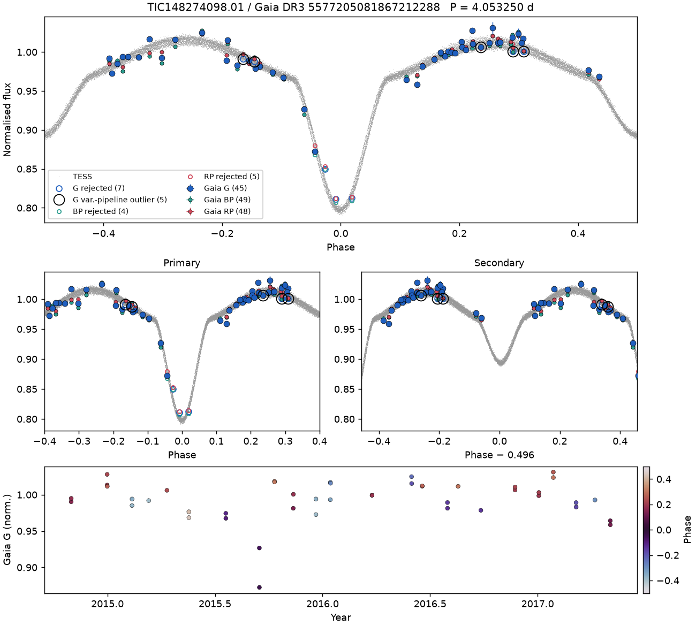

# Gaia × TESS Eclipsing Binary Atlas (`ebatlas`)

This project seeks to combine existing eclipsing binary (EB) ephemerides from TESS (and possibly other observatories later) with Gaia DR4 epoch photometry. Both missions have excellent etendue, but Gaia's sparser coverage means that sometimes it will miss a binary eclipse. With new DR4 photometry for all sources, we have the opportunity to check how often Gaia gets unlucky and misses these eclipses. This project was originally developed for the [2026 Gaia Relay](http://gaia.lol) (KITP leg). Contributions from are welcome; see [CONTRIBUTING.md](CONTRIBUTING.md) and be sure to check the [log](docs/RELAY_LOG.md).


*An example using the TEBC (Prša et al., 2022) and DR3 epoch data. Top: TESS light curve (grey) folded on its ephemeris, with Gaia G/BP/RP epochs overplotted. Middle: zoom on each eclipse; open circles mark points rejected by the Gaia pipeline. Bottom: Gaia G epochs vs time, colored by phase.

## Why

Gaia DR3 published epoch photometry only for about 11.7 million sources in its pipeline classified as variable, including ~2.2 million eclipsing-binary candidates (Mowlavi et al. 2023). DR4 publishes epoch data for *all* sources. Folding those epochs on TESS ephemerides lets us:

1. **See Gaia catching eclipses that weren't previously flagged.** With a few dozen visits and a known period, even a handful of in-eclipse points is a detection. The interesting sample is TESS EBs that are *absent* from DR3 `vari_eclipsing_binary`.
2. **Identify the true host.** In the case that Gaia catches an eclipse, it can help identify the true source of an EB, since TESS pixels are large.
3. **Measure chromatic eclipse depths.** G, BP and RP depths constrain the temperature ratio independently of TESS.
4. **Cross-check orbits.** Compare DR4 non-single-star solutions (SB1/SB2, eclipsing, astrometric) against TESS periods, and use RUWE, acceleration solutions and epoch astrometry to test for tertiaries predicted by eclipse-timing variations.


## Quick start

```bash
git clone https://github.com/doddo15/gaia-tess-eb-atlas.git && cd gaia-tess-eb-atlas
pip install -e ".[dev,online]"
pytest                                  # offline tests
```

With network access:

```bash
ebatlas-build data/TEBC.csv --catalog tebc --out atlas/ --release dr3 --limit 25
```

This writes one png per target and `atlas/summary.csv` with Gaia epoch counts, in-eclipse counts (`secure` and `possible`, given ephemeris drift), in-eclipse points rejected by Gaia, depth S/N, RUWE, and whether DR3 already flagged the source as an EB.

<!-- ## First result: TEBC ephemerides at Gaia epochs


TEBC ephemerides come from TESS sectors 1–26 (2018–2020). Gaia DR4 epochs start in mid-2014, so each ephemeris has to be projected back by up to thousands of cycles. Of the 4,574 TEBC EBs with a usable ephemeris, the median phase uncertainty at the start of DR4 is 0.013. Only 34% have σ_φ < 0.005 there, and 9% have effectively lost phase coherence (σ_φ > 0.25). By the end of DR4 these improve to 66% and 2%. Short-period, contact-like systems fare worst.

Two consequences follow. First, TEBC ephemerides should be refit using all TESS sectors to date, which extends the baseline from ~2 to ~8 years and shrinks period errors substantially. Second, the reverse is also a science product. For well-folded systems, Gaia's 2014–2019 in-eclipse epochs extend the timing baseline to ~12 years, which bears directly on period changes and tertiary companions.

Reproduce with `python examples/tebc_ephemeris_precision.py data/TEBC.csv`. -->

## Things to watch out for / work on
 
- **Ephemeris drift.** Ephemerides drift, especially for those calculated from just two years of TESS data in the PM. `Ephemeris.phase_sigma` and `is_reliable_at` flag targets whose fold is not trustworthy at Gaia epochs.
- **Normalisation.** Right now, I've normalized each band by its out-of-eclipse median so that all bands are on the same baseline.
- **Period aliases.** There are some issues with period aliases, including differences between periods calculated from the TESS data and the Gaia data. I re-calculated TEBC ephemerides from as many LCs as I could get, but that's no assurance.
- **DR3 variability rejections.** DR3's `rejected_by_variability` often flags real in-eclipse points. We keep those points, ring them on the pages, and count them (`*_var_rejected_in_eclipse`); only `rejected_by_photometry` removes a point.
- **Outlier rejection.** In DR4, outlier rejection affects only the mean photometry; epoch fluxes keep in-eclipse points. We count in-eclipse transits Gaia flagged as outliers, and plot (not drop) transits with no usable flux. The variability pipeline's epoch flags are a separate product.
- **Cross-match ambiguity.** Sometimes there are multiple DR3 sources for a given DR2 source, so I take the closest one but keep other records too. 


## Roadmap

**Before DR4.** First thing I want to do is begin with a validation on existing DR3 epochs. It's also possible we can predict which targets Gaia should catch in eclipse using the scanning law (i.e. by using ESA's Gost tool), so that's something to work in as well. I'm also refitting the TEBC ephemerides with all available TESS sectors. 

**First days of DR4.** Implement the DR4 adapter; run the full atlas; compute detection statistics as a function of depth, duty cycle and magnitude; produce the "Gaia never flagged these" sample.

**Extensions.** NSS period comparison, blend/host identification, chromatic depths, tertiary searches combining ETVs with astrometry. Astrometric sensitivity to circumbinary planets will be limited to nearby systems with massive, long-period companions, so expect mostly upper limits there.

## Input catalogs

Candidate starting catalogs: the TESS Eclipsing Binary Catalog (Prša et al. 2022), the TESS Ten Thousand catalog (Kostov et al. 2025), and TESS M+Ms (Oddo et al. 2026). Down the line, we can also fold in other EB sources like ASAS-SN, OGLE, ATLAS, WISE, or WASP. 
<!-- In the eventual future, perhaps this could work with Roman or LSST.  -->

## Credit

If you use this code, please cite the repository (I'll get to a Zenodo DOI eventually!) and the input catalogs. All relay contributors are listed in [CONTRIBUTORS.md](CONTRIBUTORS.md).
